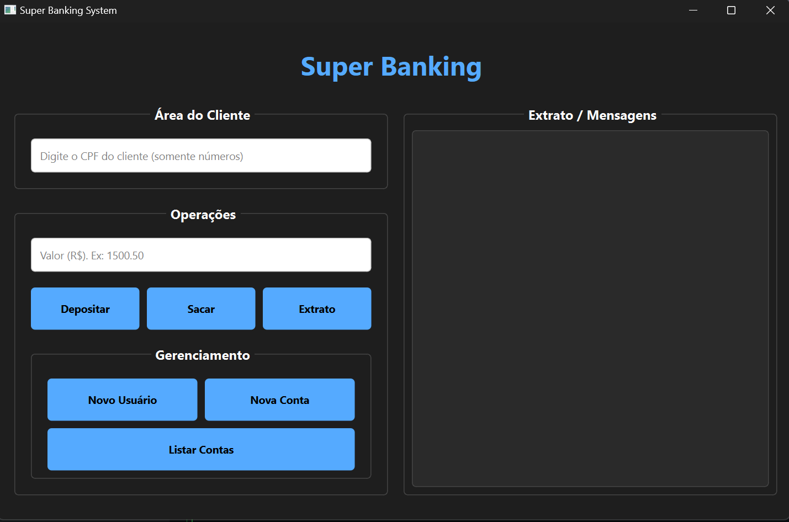

```markdown
# 🏦 Super Banking System

## 📖 Sobre o Projeto

O **Super Banking System** é uma aplicação desktop completa que simula as operações essenciais de uma agência bancária. O sistema permite o gerenciamento de clientes, abertura de contas e realização de transações financeiras com persistência de dados.

O diferencial deste projeto reside na sua arquitetura robusta: ele separa claramente a Interface Gráfica (View), a Lógica de Negócios (Controller/Model) e a Camada de Dados, além de contar com uma suíte de testes automatizados para garantir a confiabilidade das operações.


## 📸 Screenshots

<div align="center">
  
</div>


## 🚀 Funcionalidades

### 👤 Para o Usuário
* **Gestão de Clientes:** Cadastro completo com validação de dados (CPF, Nome, Endereço).
* **Múltiplas Contas:** Um cliente pode possuir várias contas, e o sistema permite alternar entre elas.
* **Transações:**
  * **Depósitos:** Crédito imediato em conta.
  * **Saques:** Com validação de saldo e limite por operação.
  * **Extrato:** Visualização do histórico de operações em tempo real na interface.
* **Interface Responsiva:** Feedback visual imediato através de logs na tela e caixas de diálogo (Pop-ups).

### ⚙️ Destaques Técnicos
* **Design Patterns:** Implementação do padrão *Command* para transações e *Factory* implícito na criação de contas.
* **Database Seguro:** Uso de **Context Managers** (`__enter__` e `__exit__`) para gerenciar conexões SQLite, garantindo commit/rollback automático.
* **Testes Automatizados:** Cobertura de testes unitários com **Pytest** para validar lógica de saldo, limites de saque e integridade do banco de dados.
* **GUI Moderna:** Interface construída com **PyQt6** e estilização via QSS (CSS para Qt).

---

## 🛠️ Tecnologias Utilizadas

* **[Python 3](https://www.python.org/)**
* **[PyQt6](https://pypi.org/project/PyQt6/)** (Interface Gráfica)
* **[SQLite3](https://www.sqlite.org/index.html)** (Banco de Dados)
* **[Pytest](https://docs.pytest.org/)** (Testes Unitários)

---

## 📂 Estrutura do Projeto

```bash
SuperBanking/
│
├── app.py                  # Entry Point (Controlador Principal da Interface)
├── banking.db              # Banco de dados (Gerado automaticamente)
├── requirements.txt        # Dependências do projeto
├── README.md               # Documentação
│
├── engine/                 # Núcleo da Lógica de Negócios
│   ├── database.py         # Gerenciador de conexão e Queries SQL
│   ├── mainwindow_qt.py    # Interface Gráfica (View)
│   ├── client.py           # Classe Base Cliente
│   ├── account.py          # Classe Base Conta
│   ├── transaction.py      # Interface Abstrata para Transações
│   └── [outros_modulos].py # checkingAccount, individual, deposit, withdraw...
│
└── tests/                  # Suíte de Testes Automatizados
    ├── test_account.py
    ├── test_client.py
    ├── test_database.py
    └── test_checking_account.py

```

---

## 📦 Como Rodar o Projeto

### 1. Clone o repositório

```bash
git clone [https://github.com/WolfatoBR/Banking-system.git]
cd Banking-system

```

### 2. Prepare o ambiente

```bash
# Crie o ambiente virtual
python -m venv venv

# Ative o ambiente (Windows)
.\venv\Scripts\activate

# Ative o ambiente (Linux/Mac)
source venv/bin/activate

```

### 3. Instale as dependências

```bash
pip install -r requirements.txt

```

*(Caso não tenha o arquivo requirements.txt, instale manualmente: `pip install PyQt6 pytest`)*

### 4. Execute a aplicação

```bash
python app.py

```

---

## 🧪 Executando os Testes

Este projeto segue boas práticas de QA. Para verificar a integridade do sistema, execute a suíte de testes:

```bash
# Rodar todos os testes com detalhes
pytest -v

# Rodar testes apenas de conta, por exemplo
pytest tests/test_account.py

```

> **Nota:** Os testes de banco de dados utilizam fixtures que criam bancos temporários, não afetando o seu banco de dados principal `banking.db`.

---

## 🧠 Exemplo de Código (Context Manager)

Um dos pontos fortes do projeto é o gerenciamento seguro de recursos. Abaixo, um trecho da classe `DataBaseManager`:

```python
def __enter__(self):
    """Abre a conexão e configura o row_factory."""
    self.conn = sqlite3.connect(self.db_path)
    self.conn.row_factory = sqlite3.Row
    return self

def __exit__(self, exc_type, exc_val, exc_tb):
    """Garante o fechamento da conexão e tratamento de exceções."""
    if self.conn:
        if exc_type is not None:
            self.conn.rollback()
        else:
            self.conn.commit()
    self.conn.close()

```

---

## ✒️ Autor

<a href="https://www.google.com/search?q=https://github.com/SEU_USUARIO">

<br />
<sub><b>WolfatoBR</b></sub></a>

Feito com 💜 e Python! 🚀